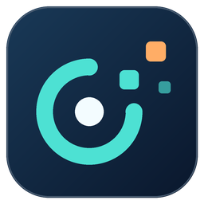

<p align="center"></p>

# DV Companion

用于 iniVation Dynamic Vision Viewer（DV）的独立 Windows 配套管理器：设备检查、可恢复项目、可靠退出与本地诊断。保留原 DV 界面，使用官方配置协议操作独立后台。

Independent Windows companion for iniVation DV: recoverable XML projects, device preflight, managed process lifecycle and local diagnostics. This is a community project, not an official iniVation release.

## 功能

- 管理本工具启动的 DV 会话，检查后台残留并提供正常退出和诊断入口。
- 项目恢复：整理 XML、检查模块与设备、备份旧结构、重建并核对模块、参数、连线及布局。
- 保存当前项目：每次保存重新读取 DV 最新状态，支持连续修改、另存检查点；读取失败不会回退到旧编辑区。
- 双机预检：固定设备序列号、检查重复设备、同步引用及循环；保存 Sync with。
- 原生后台补丁：日志递归与锁问题、UTF-8 校验、设备信息更新及相机发现/打开互斥。
- 日志和诊断只保存在本机，不自动上传。

## 环境

- Windows；已安装 .NET 10 Desktop Runtime（开发需要 .NET 10 SDK）。
- 已安装 DV。原生修复后台仅针对 DV runtime **1.7.1**、提交 `879b9d94d5d97892c4d4e3951e26349cd012084e` 验证；DAVIS 补丁使用 processing **2.0.2**。
- 当前为源码发布：不包含原 DV 安装包、闭源 Java GUI、厂商 SDK DLL 或事件录制数据。

## 构建

```powershell
dotnet build app/DVCompanion.csproj -c Release -p:NuGetAudit=false
dotnet run --project app/DVCompanion.csproj -c Release
```

仅构建 C# 管理器即可检查界面和运行基础测试。要启用完整修复后台与项目恢复，请按 [原生构建说明](docs/BUILD.md) 构建并放置 `patched-runtime`。

## 使用

1. 运行 Companion，选择 DV 安装目录；有完整修复后台时保留“使用修复后台”勾选，点击“启动 DV”。
2. 恢复项目：在“配置检查”中打开 XML，点击“恢复此项目到 DV”。原 DV 的 File → 加载项目入口仍可能遇到已观察到的导入死锁。
3. 修改后保存：直接点击“保存可恢复项目…”，自动读取当前 DV。另存 `a_new.xml` 不会改变 `a.xml`，加载不同 XML 就恢复不同检查点。
4. Sync with 对象会保存；重新启动相机或恢复项目后，Sync time 仍需手动执行。连接同步线，在主相机点击 Synchronize timestamps，确认同步状态后录制。
5. 结束时使用“正常退出本次 DV”，处理 DV 自己的退出/保存提示，等待进程表清空。

恢复项目不会自动开始录制；导出的录制模块保持停止。编辑区用于检查及恢复指定 XML，保存按钮读取的是当前 DV。

## 测试与边界

```powershell
dotnet run --project app/DVCompanion.csproj -c Release -- --self-test "$PWD/test-results.json"
```

发布前 29 项基础及回归测试通过；连续修改/保存/重载与独立后台重启恢复已验证。UI 有默认/最小窗口预览检查。硬件实测主要使用 DAVIS346 双机，尚未完成长期录制、物理热拔插或全部 GUI 操作的压力验证。

本工具不会自动强杀或重启未知录制；强制退出仍可能损坏末尾录制文件。详见 [测试说明](docs/TESTING.md) 和 [贡献说明](CONTRIBUTING.md)。

## 目录与许可证

- `app/`：C# WinForms 管理器、协议实现与测试。
- `native/`：上游来源清单、校验值、补丁及构建脚本。上游源码在构建时按固定版本下载。
- `docs/`：构建、测试与使用说明。

Companion 代码及本地改动使用 [Apache-2.0](LICENSE)，上游归属见 [NOTICE](NOTICE)。第三方依赖保留各自许可证。示例序列号均为虚构测试值；真实设备编号通过本机配置提供。
